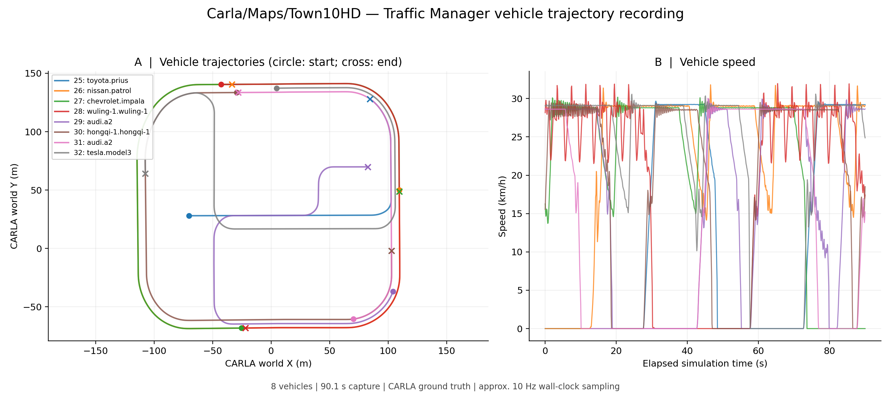

# Traffic Manager 车辆轨迹与仿真位姿跟随

本示例提供 Traffic Manager 车辆生成、轨迹记录、快照导出和可选的无人机仿真位姿跟随，默认跟随点位于车辆后方 12 米、上方 25 米。

**目标位置来自 CARLA 车辆坐标，尚未接入 YOLO 视觉闭环，也不能据此认定无人机动力学跟随已经验证通过。** 跟随使用增量 `simSetVehiclePose`，保留当前朝向。

## 环境与入口

入口位于功能包 `tools/traffic`，安装路径为 `share/openhutb_yolo_mlp_control/tools/traffic`，直接使用模拟器 API。

- Windows：运行 OpenHUTB AIR 场景和匹配版本的 CARLA Python API；车辆生成与记录使用该环境。
- WSL2 Ubuntu 22.04 / Python 3.10：运行随包提供的 AirSim 客户端和可选的位姿跟随。
- 绘图依赖：`numpy`、`matplotlib`。AirSim 客户端依赖 `numpy`、`msgpack`。

Windows 使用 HUTB 2.10.0 随附、与本机 Python 版本匹配的 wheel。

下面的 PowerShell 命令从**仓库根目录**执行。首次获取源码可运行 `git clone https://github.com/OpenHUTB/ros2.git`，然后 `cd ros2`；测试未合并 PR 时应先检出对应 PR 分支。

```powershell
$repoDir = (git rev-parse --show-toplevel).Trim()
$toolsDir = Join-Path $repoDir 'src/air/openhutb_yolo_mlp_control/tools/traffic'
$env:HUTB_ROOT = Read-Host '输入本机 OpenHUTB 模拟器目录的完整路径'
$apiEnv = Join-Path $env:LOCALAPPDATA 'OpenHUTB/traffic_api'
python -m venv $apiEnv
$carlaPython = Join-Path $apiEnv 'Scripts/python.exe'
$pythonTag = (& $carlaPython -c "import sys; print('cp%d%d' % sys.version_info[:2])").Trim()
$wheels = @(Get-ChildItem (Join-Path $env:HUTB_ROOT 'PythonAPI/carla/dist') -Filter "hutb-*-$pythonTag-*-win_amd64.whl")
if ($wheels.Count -ne 1) { throw '请使用模拟器 wheel 所支持的 Python 版本，并核对 wheel 目录' }
& $carlaPython -m pip install --no-deps $wheels[0].FullName
$runDir = Join-Path $env:LOCALAPPDATA ('OpenHUTB/traffic_runs/' + (Get-Date -Format 'yyyyMMdd_HHmmss'))
```

启动模拟器并加载地图。CARLA 默认地址为 `127.0.0.1:2000`，可通过 `--host`、`--port` 修改。

## 生成车辆与记录轨迹

第一个 PowerShell 终端生成 8 辆车并保持运行，按 `Ctrl+C` 清理**本进程创建的车辆**：

```powershell
& $carlaPython "$toolsDir/main.py" spawn --count 8
```

第二个 PowerShell 终端在仓库根目录记录车辆：

```powershell
$repoDir = (git rev-parse --show-toplevel).Trim()
$toolsDir = Join-Path $repoDir 'src/air/openhutb_yolo_mlp_control/tools/traffic'
$carlaPython = Join-Path $env:LOCALAPPDATA 'OpenHUTB/traffic_api/Scripts/python.exe'
$runDir = Join-Path $env:LOCALAPPDATA ('OpenHUTB/traffic_runs/' + (Get-Date -Format 'yyyyMMdd_HHmmss'))
& $carlaPython "$toolsDir/main.py" record --output $runDir --duration 90
```

记录对象为本工具生成的车辆（`role_name=openhutb_traffic_demo`）。`--duration 0` 表示持续记录。另提供 `launch.ps1` 前台启动入口。

输出包括：

| 文件 | 内容 |
| --- | --- |
| `vehicle_trajectories.csv` | 时间戳、模拟帧号、车辆 ID、车型、位置、朝向和速度 |
| `metadata.json` | 当前地图、实际采集时长和记录数量 |
| `references.json` | 当前地图中用于校准的静态场景参考点 |
| `live.json` | 最新车辆状态，供可选的跟随入口读取 |

车辆 CSV 使用 CARLA 左手世界坐标，位置、朝向、速度单位分别为米、度、米每秒；按墙钟约 10 Hz 采样并跳过重复模拟帧。

## 可选：生成轨迹快照

采集完成后，可在同一个 Windows Python 环境安装绘图依赖并导出 PNG、PDF 和每辆车的统计 CSV：

```powershell
& $carlaPython -m pip install numpy matplotlib
& $carlaPython "$toolsDir/plot_trajectories.py" --data $runDir
```



圆点和叉号分别表示记录起点和终点；速度曲线使用模拟时间与水平速度，行驶距离按相邻二维位置采样点累加。

## 可选：WSL 仿真位姿跟随

记录入口使用 `--duration 0` 持续运行；位姿跟随默认运行 90 秒，结束时取消运动任务并释放 API 控制。

在第二个 PowerShell 终端（保留 `$repoDir` 和 `$runDir`）打开定位到同一源码目录的 WSL 终端，并打印本次数据目录的 WSL 路径：

```powershell
wsl.exe -d Ubuntu-22.04 -e wslpath -u $runDir
wsl.exe -d Ubuntu-22.04 --cd $repoDir
```

随后在 WSL 中执行：

```bash
python3 -m venv "$HOME/.venvs/openhutb_traffic"
source "$HOME/.venvs/openhutb_traffic/bin/activate"
python -m pip install -r src/air/openhutb_yolo_mlp_control/tools/traffic/requirements.txt
export REPO_DIR="$(git rev-parse --show-toplevel)"
export TOOLS_DIR="$REPO_DIR/src/air/openhutb_yolo_mlp_control/tools/traffic"
read -r -p '输入上面 wslpath 输出的本次数据目录: ' TRAFFIC_DATA
export TRAFFIC_DATA
read -r -p '输入当前已验证可达的 Windows 主机 IP: ' AIRSIM_IP
export AIRSIM_IP
python - <<'PY'
import os, socket
with socket.create_connection((os.environ['AIRSIM_IP'], 41451), timeout=3):
    print('AirSim TCP reachable')
PY
python "$TOOLS_DIR/follow_vehicle.py" --data "$TRAFFIC_DATA" \
  --host "$AIRSIM_IP" --enable-pose-control --duration 90
```

脚本通过 5～20 个共同静态对象校准 CARLA 与 AirSim 坐标，允许残差为 0.25 米，适用于坐标轴对齐、Z 方向相反的场景。默认选择附近移动车辆，可用 `--target-id` 指定。

`drone_follow.csv` 记录无人机与期望点的 NED 坐标、水平误差和阶段；`follow_status.json` 保存运行与控制释放状态。碰撞、目标消失、地图改变或车辆数据超时会结束跟随。

另一个 WSL 终端设置相同的 `TRAFFIC_DATA` 后，可暂停、恢复或结束跟随：

```bash
# 暂停并保持位置
touch "$TRAFFIC_DATA/follow_pause"
# 恢复跟随
rm -f "$TRAFFIC_DATA/follow_pause"
# 结束跟随并释放控制
touch "$TRAFFIC_DATA/follow_exit"
```

也可按 `Ctrl+C` 结束跟随；释放控制不执行降落或悬停。

## 验证结果

Windows 11、Python 3.13.14、HUTB 2.10.0 / Town10HD 下采集约 90.08 秒，共 8 辆车、7064 条记录。[采集元数据](../../img/air/openhutb_yolo_mlp_control/traffic_capture_metadata.json)与[各车统计](../../img/air/openhutb_yolo_mlp_control/traffic_vehicle_summary.csv)随图提供。WSL2 Ubuntu 22.04 / Python 3.10 下完成绘图，6 项离线测试通过。

无人机跟随入口的鼠标视角与退出效果仍待在线复验。

返回[文档目录](README.md)。

## 说明

本文档整理、代码重构和问题排查过程中使用了大模型辅助；提交者已检查全部内容并对最终结果负责。
